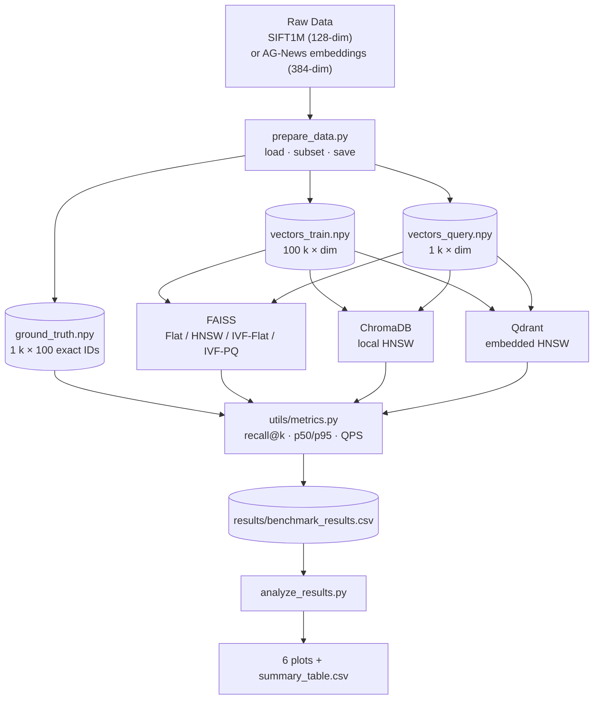

# Vector Search Benchmark

> Compare FAISS, ChromaDB, and Qdrant on the same 100 k-vector dataset.
> Measure recall@10, latency (p50/p95), throughput (QPS), build time, and memory.

---

## Goal

Modern ML applications (RAG pipelines, recommendation engines, semantic search)
rely on **approximate nearest-neighbour (ANN) search**.  The right index type
depends on the trade-off between accuracy, speed, and memory.  This project
benchmarks the most common choices in a reproducible, Windows-native setup.

---

## Architecture



---

## Setup (Windows PowerShell, Python 3.11+)

```powershell
# 1. Create and activate a virtual environment
cd "D:\Data Engineering Projects\vector-search-benchmark"
python -m venv .venv
.\.venv\Scripts\Activate.ps1

# 2. Install dependencies
pip install --upgrade pip
pip install -r requirements.txt

# If faiss-cpu fails (rare), try:
#   pip install faiss-cpu --index-url https://pypi.org/simple/

# 3. Run the tests to verify the environment
python -m pytest tests/ -v
```

> **Memory note**: the full run uses at most ~2–3 GB RAM.  
> If you are on a very tight 8 GB machine, reduce `n_train` to 50 000 in
> `config.yaml` before running.

---

## Reproducing Results

```powershell
# Step 1 — prepare data (downloads SIFT1M HDF5, ~468 MB, once)
python data\prepare_data.py

# Step 2 — run all benchmarks (takes 20–60 min on a laptop CPU)
python run_benchmark.py

# Step 3 — generate plots and summary table
python analyze_results.py
```

**Run only one system** (useful for testing):

```powershell
python run_benchmark.py --only faiss
python run_benchmark.py --only chroma
python run_benchmark.py --only qdrant
```

**Force re-download** (if data files are corrupt):

```powershell
python run_benchmark.py --redownload
```

**Use the sentence-transformers fallback** (if SIFT1M download fails):  
Edit `config.yaml` and set `source: "sentence_transformers"`, then rerun.

---

## Results

> **Note**: the numbers below are placeholders.  
> Run the benchmark yourself and fill them in.

### Summary Table

| System  | Index    | Best params                        | Recall@10 | QPS    | p50 ms | Build (s) | Mem MB |
|---------|----------|------------------------------------|-----------|--------|--------|-----------|--------|
| FAISS   | Flat     | —                                  | _TBD_     | _TBD_  | _TBD_  | _TBD_     | _TBD_  |
| FAISS   | HNSW     | M=32, efSearch=128                 | _TBD_     | _TBD_  | _TBD_  | _TBD_     | _TBD_  |
| FAISS   | IVF-Flat | nlist=256, nprobe=32               | _TBD_     | _TBD_  | _TBD_  | _TBD_     | _TBD_  |
| FAISS   | IVF-PQ   | nlist=256, nprobe=32, M_pq=16      | _TBD_     | _TBD_  | _TBD_  | _TBD_     | _TBD_  |
| Chroma  | HNSW     | M=32, ef_c=200, ef_s=128           | _TBD_     | _TBD_  | _TBD_  | _TBD_     | _TBD_  |
| Qdrant  | HNSW     | M=32, ef_c=200, ef_s=128           | _TBD_     | _TBD_  | _TBD_  | _TBD_     | _TBD_  |

### Plots

After running `analyze_results.py`, these files appear in `results/`:

| File                     | Shows                                             |
|--------------------------|---------------------------------------------------|
| `recall_vs_latency.png`  | Main trade-off scatter (all systems + configs)    |
| `recall_vs_qps.png`      | Throughput vs accuracy                            |
| `build_time.png`         | How long each index takes to build                |
| `memory_usage.png`       | Extra RAM consumed during index build             |
| `hnsw_param_sweep.png`   | FAISS HNSW: recall vs ef_search per M             |
| `ivf_param_sweep.png`    | FAISS IVF: recall vs nprobe per nlist             |

---

## Which Index for Which Scenario?

| Scenario                     | Recommended index      | Why                                                       |
|------------------------------|------------------------|-----------------------------------------------------------|
| Small dataset (< 10 k vecs)  | FAISS Flat             | Exact, fast enough, no parameter tuning needed            |
| Memory-limited device        | FAISS IVF-PQ           | ~8× smaller than IVF-Flat due to quantization             |
| High-recall production API   | FAISS HNSW (M≥32)      | Near-perfect recall, constant query time, no re-train     |
| Incremental inserts          | HNSW (FAISS or Qdrant) | HNSW supports live inserts; IVF needs periodic re-train   |
| RAG / LLM application        | Chroma or Qdrant       | Built-in metadata filtering, easy SDK, managed lifecycle  |
| Largest dataset, low memory  | FAISS IVF-PQ + on-disk | Compressed codes fit in RAM even for billion-scale         |

---

## How HNSW Works (Interview-Ready Explanation)

**HNSW (Hierarchical Navigable Small World)** builds a layered graph:

1. **Layers**: Each vector is assigned to a random maximum layer (exponentially
   fewer vectors at higher layers).  Layer 0 contains every vector.
2. **Connections**: When inserting a vector, the algorithm greedily traverses
   the graph from the top layer down, keeping the `M` nearest neighbours at
   each layer.  These become the new node's edges.
3. **Search**: Start at the entry point in the top layer, greedily hop to
   nearer nodes, descend to layer 0, then perform a beam search with width
   `ef_search`.

**Key parameters**:
- `M`: edges per node — higher = better recall, more memory, slower build.
- `ef_construction`: beam width during build — higher = better graph quality.
- `ef_search`: beam width at query time — increase to trade latency for recall.

**Complexity**: O(log N) build per insert; O(log N) query time empirically.

---

## How IVF Works (Interview-Ready Explanation)

**IVF (Inverted File Index)**:

1. **Training**: Run k-means on the training vectors to find `nlist` centroids
   (Voronoi cells).
2. **Indexing**: Assign each vector to its nearest centroid and store it in
   that centroid's "posting list" (like an inverted index in text search).
3. **Search**: Compute the distance from the query to every centroid (cheap:
   only `nlist` distances), pick the nearest `nprobe` centroids, then search
   only those posting lists exactly.

**IVF-PQ**: Further compress each residual vector using **Product Quantization**
— split the vector into `M_pq` sub-vectors and encode each with an 8-bit code
(256 codewords per sub-space).  Reduces storage by ~8×; recall drops slightly.

**Key parameters**:
- `nlist`: number of Voronoi cells — more cells = finer partition, faster search.
- `nprobe`: cells to visit at query time — higher = better recall, slower.

**Rule of thumb**: set `nlist ≈ sqrt(N)` and start with `nprobe = nlist / 10`.

---

## 5 Professor Questions & Short Answers

**Q1. Why does recall@10 increase as ef_search grows but eventually plateau?**  
A: `ef_search` controls the beam-search width in HNSW.  Larger values explore
more nodes per layer, finding closer neighbours.  Past a threshold the beam
already includes all true top-10 neighbours, so further increase gives no gain.

**Q2. IVF-PQ has lower recall than IVF-Flat.  What causes the gap?**  
A: PQ reconstructed distances are approximate.  The encoder introduces
quantization error.  At low `nprobe` some true neighbours may land in
unvisited cells *and* their distances may be distorted, compounding the error.

**Q3. FAISS Flat always returns recall=1.0.  Why use it as ground truth?**  
A: Flat performs an exhaustive L2 scan — it is exact by definition.  All other
indexes are approximate; we measure how well they approximate Flat's output.

**Q4. ChromaDB is slower than FAISS HNSW even though both use HNSW.  Why?**  
A: ChromaDB adds per-query overhead: SQLite metadata reads, Python-level
serialization, and JSON encoding/decoding for the result.  FAISS operates on
raw contiguous C++ arrays with no marshalling cost.

**Q5. Why must IVF indexes be trained before adding vectors?**  
A: Training runs k-means to learn the centroid positions.  The centroids must
reflect the data distribution before vectors can be assigned to cells.  HNSW
and Flat require no training because they insert vectors incrementally.

---

## Technical Report Outline (2–3 pages)

**1. Introduction** (~0.5 p)  
Problem: vector databases power modern ML applications.  Choosing an index
type involves accuracy vs. speed vs. memory trade-offs with no universal winner.
Research question: how do FAISS (Flat/HNSW/IVF-Flat/IVF-PQ), ChromaDB, and
Qdrant compare on a controlled 100 k-vector benchmark?

**2. Background** (~0.5 p)  
Brief description of HNSW, IVF, PQ compression, and product quantization.
Metrics: recall@k, QPS, p50/p95 latency, peak RSS, build time.

**3. Methodology** (~0.5 p)  
Dataset: SIFT1M subset (128-dim, L2).  Ground truth computed with FAISS Flat.
Parameter grid: HNSW M ∈ {16,32,64}, ef_search ∈ {32,64,128,256};
IVF nlist ∈ {128,256,512}, nprobe ∈ {8,16,32,64,128}; PQ M_pq=16, nbits=8.
Environment: single CPU thread, Windows 11, 8 GB RAM.

**4. Results** (~0.5 p)  
Table of best-config per system+index (recall, QPS, latency, memory).
Recall vs latency scatter plot.  HNSW and IVF parameter sweep line charts.

**5. Analysis & Limitations** (~0.5 p)  
Interpretation of which index fits which use case.  Limitations: single thread
(FAISS supports OpenMP), Qdrant local mode is Python (not Rust server),
ChromaDB overhead from metadata layer.  Future work: scale to 1 M vectors, GPU.

---

## License

MIT
