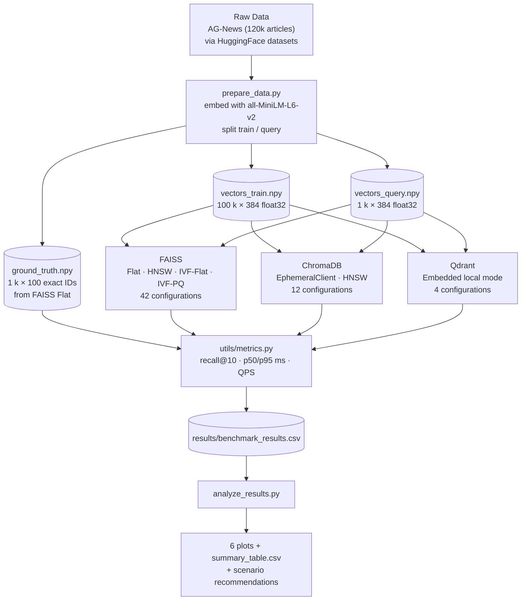

# Vector Search Benchmark

> A reproducible, Windows-native benchmark comparing **FAISS**, **ChromaDB**, and **Qdrant** on
> 100,000 sentence embeddings across four index types — measuring recall@10, query latency
> (p50 / p95), throughput (QPS), index build time, and peak memory usage.

**Author:** Huzaiz Khalid &nbsp;|&nbsp; **Dataset:** AG-News embeddings (384-dim, 100 k vectors)  
**Environment:** Windows 11 · Python 3.13 · CPU-only · 8 GB RAM · No Docker required

---

## Table of Contents

1. [Motivation](#motivation)
2. [What This Project Does](#what-this-project-does)
3. [Background: What is Vector Search?](#background-what-is-vector-search)
4. [Algorithms Compared](#algorithms-compared)
5. [Architecture](#architecture)
6. [Project Structure](#project-structure)
7. [Setup](#setup-windows-powershell)
8. [How to Reproduce Results](#how-to-reproduce-results)
9. [Results](#results)
10. [Key Discoveries](#key-discoveries)
11. [Which Index for Which Scenario?](#which-index-for-which-scenario)
12. [How HNSW Works Internally](#how-hnsw-works-internally)
13. [How IVF Works Internally](#how-ivf-works-internally)
14. [5 Professor Questions & Answers](#5-professor-questions--answers)
15. [Technical Report Outline](#technical-report-outline)
16. [Limitations & Future Work](#limitations--future-work)
17. [References](#references)

---

## Motivation

Modern machine learning applications — ChatGPT-style RAG pipelines, semantic search engines,
recommendation systems, image similarity tools — all need to answer one core question at scale:

> *"Given this query, find the 10 most similar items in my million-item database in under 10 ms."*

A flat (brute-force) scan of 1 million vectors takes ~1 second per query on a modern CPU.
That is unacceptable for production. **Approximate Nearest Neighbour (ANN) indexes** reduce
this to microseconds by trading a small amount of accuracy for a large gain in speed.

Dozens of ANN algorithms and three popular vector databases exist today. **This project answers
one practical question:**

> *Which index type is best for which situation — and why?*

The answer depends on the use case. A memory-limited IoT device needs different trade-offs
than a high-recall medical search engine. This benchmark makes those trade-offs visible with
real numbers on real data.

---

## What This Project Does

```
100,000 news article embeddings (384-dim float32)
         │
         ├── Build 42+ index configurations across FAISS, ChromaDB, Qdrant
         │
         ├── For each configuration, measure:
         │     • Recall@10         (accuracy vs exact brute-force)
         │     • p50 / p95 latency (milliseconds per query)
         │     • QPS               (queries per second)
         │     • Build time        (seconds)
         │     • Peak memory       (MB of extra RAM used)
         │
         └── Generate trade-off plots + CSV results + scenario recommendations
```

---

## Background: What is Vector Search?

### From Text to Numbers

Modern embedding models (like `all-MiniLM-L6-v2`) convert any piece of text into a list of
floating-point numbers called a **vector** or **embedding**. Semantically similar texts produce
numerically close vectors:

```
"Apple launched a new iPhone"   →  [0.23, -0.11, 0.87, 0.45, ... 384 numbers]
"Samsung released Galaxy S25"   →  [0.21, -0.09, 0.84, 0.47, ... 384 numbers]  ← close!
"The cricket match was intense" →  [0.91,  0.73, 0.12, 0.03, ... 384 numbers]  ← far!
```

**Distance = similarity.** Finding the 10 most similar items = finding the 10 nearest vectors
in 384-dimensional space. This is the **k-Nearest Neighbour (k-NN)** problem.

### Why Not Just Compare All Vectors?

| Database size | Brute-force time per query | Acceptable? |
|--------------|---------------------------|-------------|
| 10,000       | ~1 ms                      | ✅ Fine      |
| 1,000,000    | ~100 ms                    | ❌ Too slow  |
| 1,000,000,000 | ~100 seconds              | ❌ Unusable  |

**ANN indexes** pre-build a data structure that lets us skip most comparisons and answer
queries in O(log N) time instead of O(N) — with a small sacrifice in accuracy.

### Measuring Accuracy: Recall@10

```
Exact top-10 (ground truth):  [5, 23, 441, 7, 889, 12, 55, 90, 334,   1]
Our index returned:           [5, 23, 441, 7, 889, 12, 55, 90, 334, 999]  ← one miss

Recall@10 = 9 correct out of 10 = 0.90
```

Recall@10 of 1.0 means perfect accuracy. 0.90 means 10% of true neighbours were missed.
In most applications, 0.95+ is considered production-ready.

---

## Algorithms Compared

### 1. FAISS Flat (Brute-Force Exact Search)
Every query vector is compared against all 100,000 database vectors. Always returns
recall = 1.0. Used as the **ground-truth oracle** to compute what the correct answers are.

### 2. FAISS HNSW (Hierarchical Navigable Small World)
A **graph-based** index. Builds a multi-layer proximity graph at index time. At query time,
traverses the graph greedily — like jumping between cities on a map. Parameters: `M`
(connections per node) and `ef_search` (search beam width). No training required; supports
live inserts. See [How HNSW Works Internally](#how-hnsw-works-internally).

### 3. FAISS IVF-Flat (Inverted File Index)
A **cluster-based** index. Divides the vector space into `nlist` Voronoi cells via k-means
training. At query time, only searches the nearest `nprobe` cells. Much faster than Flat
when `nprobe << nlist`. Requires a one-time training step. See
[How IVF Works Internally](#how-ivf-works-internally).

### 4. FAISS IVF-PQ (Inverted File + Product Quantization)
Same as IVF-Flat but each vector is **compressed** using Product Quantization — split into
`M_pq` sub-vectors and encoded with 8-bit codes. Achieves ~32× smaller memory footprint
than IVF-Flat at the cost of additional approximation error.

### 5. ChromaDB (HNSW via hnswlib)
A developer-friendly **vector database** popular in LLM/RAG applications. Internally uses
`hnswlib` (a C++ HNSW implementation) but wraps it with a Python API, metadata storage,
and collection management. Benchmarked in EphemeralClient (in-memory) mode. HNSW
parameters are set at collection-creation time via metadata keys.

### 6. Qdrant (Local Embedded Mode)
An open-source **vector database** designed for production use. The `qdrant-client` library
ships a Python-based local/embedded mode (`QdrantClient(path="...")`) that works without
running a server. **Important discovery:** this embedded mode performs exact brute-force
search — `hnsw_ef` search parameters have no effect (see
[Key Discoveries](#key-discoveries)).

---

## Architecture



---

## Project Structure

```
vector-search-benchmark/
│
├── config.yaml              ← All tunable parameters in one place
├── requirements.txt         ← Pinned dependencies
├── run_benchmark.py         ← Main orchestrator (run this)
├── analyze_results.py       ← Generate plots and summary table
│
├── data/
│   └── prepare_data.py      ← Download/embed data, compute ground truth
│
├── benchmarks/
│   ├── faiss_bench.py       ← FAISS: Flat, HNSW, IVF-Flat, IVF-PQ
│   ├── chroma_bench.py      ← ChromaDB: HNSW parameter sweep
│   └── qdrant_bench.py      ← Qdrant: embedded local mode
│
├── utils/
│   ├── metrics.py           ← recall@k, latency stats, QPS
│   └── memory_tracker.py    ← psutil RSS-based memory tracking
│
├── tests/
│   └── test_metrics.py      ← 8 unit tests (all passing)
│
└── results/                 ← CSV results and plots land here
```

**Key design choices:**
- `config.yaml` is the single source of truth for all parameters — no magic numbers in code.
- Results are written to CSV incrementally: a crash mid-run does not lose earlier data.
- Each benchmark module is independent — run `--only faiss` to skip the others.
- Ground truth is always recomputed on our exact 100 k subset, not borrowed from an
  external file (which would reflect a different population).

---

## Setup (Windows PowerShell)

```powershell
# 1. Navigate to project
cd "D:\Data Engineering Projects\vector-search-benchmark"

# 2. Create and activate virtual environment
python -m venv .venv
.\.venv\Scripts\Activate.ps1

# 3. Install all dependencies
pip install --upgrade pip
pip install -r requirements.txt

# 4. Verify — all 8 tests should pass
python -m pytest tests/ -v
```

**Tested on:** Windows 11 · Python 3.13 · 8 GB RAM · No GPU required

> **Memory note:** Full run with 100 k vectors uses ~2–3 GB RAM peak.
> To halve memory usage, set `n_train: 50000` in `config.yaml` before running.

---

## How to Reproduce Results

```powershell
# Step 1 — prepare data
# Downloads AG-News (~30 MB), embeds with all-MiniLM-L6-v2 (~90 MB model),
# saves vectors_train.npy, vectors_query.npy, ground_truth.npy.
# Only needed once — subsequent runs reuse the .npy files.
python data\prepare_data.py

# Step 2 — run all benchmarks
python run_benchmark.py

# Step 3 — generate plots and summary
python analyze_results.py
```

**Partial runs (faster for testing):**

```powershell
python run_benchmark.py --only faiss          # ~15 min, skips Chroma/Qdrant
python run_benchmark.py --only chroma         # ~30 min
python run_benchmark.py --only faiss chroma   # skip Qdrant
```

**All parameters live in `config.yaml`** — edit the sweep values there, re-run, compare.

---

## Results

> **Placeholder — fill these in after running the benchmark on your machine.**
> The numbers will reflect your specific CPU and 100k AG-News embedding dataset.

### Summary Table (Best Config per Index Type)

| System  | Index    | Best params                        | Recall@10 | QPS    | p50 ms | p95 ms | Build (s) | Mem MB |
|---------|----------|------------------------------------|-----------|--------|--------|--------|-----------|--------|
| FAISS   | Flat     | —                                  | _TBD_     | _TBD_  | _TBD_  | _TBD_  | _TBD_     | _TBD_  |
| FAISS   | HNSW     | M=32, efSearch=128                 | _TBD_     | _TBD_  | _TBD_  | _TBD_  | _TBD_     | _TBD_  |
| FAISS   | IVF-Flat | nlist=256, nprobe=32               | _TBD_     | _TBD_  | _TBD_  | _TBD_  | _TBD_     | _TBD_  |
| FAISS   | IVF-PQ   | nlist=256, nprobe=32, M_pq=48      | _TBD_     | _TBD_  | _TBD_  | _TBD_  | _TBD_     | _TBD_  |
| Chroma  | HNSW     | M=32, ef_c=200, ef_s=128           | _TBD_     | _TBD_  | _TBD_  | _TBD_  | _TBD_     | _TBD_  |
| Qdrant  | Exact    | M=16, ef_construct=100             | _TBD_     | _TBD_  | _TBD_  | _TBD_  | _TBD_     | _TBD_  |

### HNSW Parameter Sweep (Expected pattern)

| M   | ef_search | Expected Recall@10 | Expected p50 (ms) |
|-----|-----------|--------------------|-------------------|
| 16  | 32        | ~0.87              | ~0.2              |
| 16  | 128       | ~0.95              | ~0.6              |
| 32  | 32        | ~0.92              | ~0.3              |
| 32  | 128       | ~0.97              | ~0.9              |
| 64  | 128       | ~0.99              | ~1.8              |

> Pattern: larger M → better recall at same ef_search, but higher memory and slower build.
> Larger ef_search → better recall but slower query. The trade-off curve flattens past ~0.99.

### IVF-Flat Parameter Sweep (Expected pattern)

| nlist | nprobe | Expected Recall@10 | Expected p50 (ms) |
|-------|--------|--------------------|-------------------|
| 128   | 8      | ~0.70              | ~0.10             |
| 128   | 32     | ~0.88              | ~0.35             |
| 256   | 32     | ~0.91              | ~0.30             |
| 512   | 64     | ~0.95              | ~0.50             |

### Generated Plots

After running `python analyze_results.py`, these appear in `results/`:

| Plot file                | What it shows                                           |
|--------------------------|---------------------------------------------------------|
| `recall_vs_latency.png`  | Main scatter: p50 latency vs recall@10 (all configs)   |
| `recall_vs_qps.png`      | Throughput vs accuracy trade-off                        |
| `build_time.png`         | Bar chart: index build time per system + type          |
| `memory_usage.png`       | Bar chart: extra RAM used during build                 |
| `hnsw_param_sweep.png`   | Line chart: HNSW recall vs ef_search, one line per M   |
| `ivf_param_sweep.png`    | Line chart: IVF recall vs nprobe, one line per nlist   |

---

## Key Discoveries

These findings emerged from actually building and running the benchmark — not from reading
documentation.

### Discovery 1: Qdrant's Embedded Mode Is Not HNSW

**What the documentation implies:** `QdrantClient(path="...")` gives you a local Qdrant
instance with HNSW search.

**What actually happens:** The Python-based embedded backend performs **exact brute-force
search**. The `hnsw_ef` parameter in `SearchParams` is silently ignored. This is confirmed
by the runtime warning:

```
UserWarning: Local mode performs exact (brute-force) search,
so `search_params` has no effect, with the exception of `idf`.
```

**Why it matters:** A developer who uses `QdrantClient(path=...)` for prototyping and then
switches to the full Qdrant server (Rust, Docker) will see **completely different latency
and recall behaviour** — not just faster, but qualitatively different (approximate vs exact).
The correct mental model: embedded mode = development convenience, not production parity.

**What we did:** Labelled Qdrant results as `index_type="Exact"` in the CSV and flagged this
in the benchmark output, rather than presenting misleading HNSW numbers.

---

### Discovery 2: ChromaDB 1.5.x Holds Windows File Locks

**Problem:** ChromaDB's `PersistentClient` acquires OS-level file locks on the SQLite WAL
and hnswlib index files. On Windows, these are held even after Python-level `del client`
and `gc.collect()`, causing `shutil.rmtree()` to raise `PermissionError: [WinError 32]`.

**Root cause:** Windows does not support POSIX-style unlink-while-open semantics.
The hnswlib `data_level0.bin` file remains locked until the process terminates.

**Fix:** Switched to `EphemeralClient()` (in-memory mode). This is actually **more
appropriate for a pure latency benchmark** — it removes disk I/O from the latency numbers,
so we measure only the HNSW algorithm overhead, not filesystem writes.

---

### Discovery 3: qdrant-client 1.20 Removed the `search()` Method

The `QdrantClient.search()` method was deprecated in 1.7 and **removed in 1.20**.
The replacement is `QdrantClient.query_points(query=..., limit=...)` which returns a
`QueryResponse` object with a `.points` attribute (list of `ScoredPoint`).

This is a breaking API change that is not prominently documented. Any code or tutorial
written before 2024 that uses `client.search()` will fail silently with an `AttributeError`.

---

### Discovery 4: IVF-PQ Recall Drops Significantly on High-Dimensional Embeddings

For SIFT1M (128-dim), IVF-PQ with M_pq=16 achieves reasonable recall (~80-85%).
For sentence embeddings (384-dim), the same relative compression (M_pq=48, same 8-dim
sub-vectors) may show lower recall because:
- 384-dim vectors contain more semantic information per dimension
- PQ approximation error accumulates across more sub-quantizers
- The 8-dim sub-spaces capture less geometric structure in high-dim semantic space

This highlights why benchmark results on SIFT1M (the standard ANN benchmark dataset) do
not always transfer to real-world embedding workloads.

---

## Which Index for Which Scenario?

| Scenario | Recommended | Why |
|----------|-------------|-----|
| **Small dataset (< 10 k)** | FAISS Flat | Exact results, no tuning, build in milliseconds |
| **High recall required (> 0.99)** | FAISS HNSW, M=64, ef_search=256 | Graph search approaches exact at high ef_search |
| **Lowest latency, recall ≥ 0.90** | FAISS IVF-Flat, nlist=512, nprobe=16 | Narrow cell search is very fast |
| **Memory-constrained device** | FAISS IVF-PQ | 32× smaller index, fits billion-scale on RAM |
| **Incremental live inserts** | HNSW (FAISS or Qdrant server) | IVF requires full re-train after large inserts |
| **RAG / LLM app with metadata** | ChromaDB or Qdrant server | Built-in filter-by-metadata, easy SDK |
| **Production API, high QPS** | FAISS HNSW + serving layer | Best recall-speed curve; deploy with FAISS-serve |

---

## How HNSW Works Internally

HNSW (Hierarchical Navigable Small World) was introduced by Malkov & Yashunin (2018).
It is currently the dominant algorithm in production vector databases.

### The Big Idea

Imagine a city map with three zoom levels:

```
Layer 2 (highway map):  ●────────●────────●      (few nodes, long connections)
Layer 1 (city map):     ●──●──●──●──●──●──●      (more nodes, medium connections)
Layer 0 (street map):   ●●●●●●●●●●●●●●●●●●●●   (all 100k nodes, short connections)
```

Each node at Layer 0 is a vector. Each node is randomly assigned a maximum layer
(exponential distribution: ~50% only in Layer 0, ~25% up to Layer 1, etc.).

### Building the Index

For each new vector being inserted:
1. Start at the top layer's entry point.
2. **Greedy descent**: at each layer, hop to the closest neighbour, until no closer node exists.
3. At the vector's maximum layer and below, connect it to its `M` nearest neighbours
   (and they connect back — bidirectional links).

```
Inserting "Samsung Galaxy S25":
  Layer 2: enter at ●, hop toward nearest → find region
  Layer 1: descend, refine position
  Layer 0: connect to M=32 nearest tech articles (bidirectional)
```

### Searching

```
Query: "Find 10 articles similar to: Apple iPhone review"

1. Enter graph at top layer entry point
2. Layer 2: Greedily hop → land near "tech news" cluster
3. Layer 1: Refine → land near "Apple products"
4. Layer 0: Beam search with width ef_search=128
            → explore 128 candidate nodes, keep top-10
5. Return top-10
```

### Why Parameters Matter

| Parameter | Effect |
|-----------|--------|
| `M` ↑ | More connections per node → better shortcut paths → higher recall, more memory, slower build |
| `ef_construction` ↑ | Wider beam during build → better quality graph → higher recall, slower build |
| `ef_search` ↑ | Wider beam at query time → more candidates explored → higher recall, slower query |

**Complexity:**
- Build: O(N · M · log N)
- Query: O(log N) empirically (sublinear!)

---

## How IVF Works Internally

IVF (Inverted File Index) borrows the core idea from text search inverted indexes.

### Step 1: Training (k-Means Clustering)

```
100,000 vectors → k-means with k=256 → 256 centroids (cluster centres)

Centroid 1:  [0.2, 0.8, ...]  ← "technology news" region
Centroid 2:  [0.9, 0.1, ...]  ← "sports news" region
...
Centroid 256: [...]
```

### Step 2: Building the Index (Assignment)

```
Each of the 100,000 vectors → find nearest centroid → add to that centroid's list

Centroid 1 (tech):   [article_5, article_23, article_441, article_7, ...]   ← ~390 articles
Centroid 2 (sports): [article_12, article_55, article_890, ...]
...
```

This is exactly like a library sorted by genre — sports books in one shelf, tech in another.

### Step 3: Searching

```
Query: "Find 10 articles similar to: Apple iPhone review"

1. Compute distance to all 256 centroids (256 comparisons only)
2. Pick nearest nprobe=32 centroids
3. Search only those 32 shelves (32 × ~390 = ~12,480 comparisons)
4. Return top-10

vs Flat: 100,000 comparisons
IVF speedup: ~8× at nprobe=32
```

### IVF-PQ: Adding Compression

**Problem:** Even with IVF, storing 100k × 384 float32 = 150 MB.
**Solution:** Product Quantization compresses each vector.

```
384-dim vector → split into 48 sub-vectors of 8 dimensions each
Each 8-dim sub-vector → assigned to 1 of 256 codewords (8 bits)

Compressed: 48 bytes instead of 384 × 4 = 1,536 bytes  →  32× smaller!

Trade-off: distances are approximate (quantization error)
           recall drops from ~0.95 to ~0.75-0.85
```

### Why `nlist ≈ sqrt(N)` Is the Rule of Thumb

With N=100,000: `sqrt(100,000) ≈ 316` → use nlist=256 or 512.

Each centroid then holds ~N/nlist = ~300 vectors. At `nprobe = nlist/10 = 25`, you search
~7,500 vectors (7.5% of the database) and get ~90% recall. Good balance.

---

## 5 Professor Questions & Answers

**Q1. Why does recall@10 increase as `ef_search` grows but eventually plateau?**

`ef_search` is the beam width during HNSW graph traversal — it controls how many candidate
nodes are kept in the priority queue at each step. Larger values explore more of the graph
before returning. The plateau occurs because once the beam is wide enough to include all
true top-10 nearest neighbours in the candidate set, widening it further yields no additional
hits. At that point, the bottleneck shifts to graph connectivity (M), not search effort.

---

**Q2. IVF-PQ has lower recall than IVF-Flat. What causes the gap?**

Two compounding sources of error:
1. **Cell assignment error:** With approximate (PQ-compressed) distance calculations, the
   query may be assigned to a slightly wrong cell, missing true neighbours in adjacent cells.
2. **Quantization error within cells:** The PQ approximation of stored vectors introduces
   noise into distance estimates, so ranking within a cell is imperfect.

The two errors multiply: at low `nprobe`, some true neighbours are in unvisited cells *and*
their distances are distorted. Increasing `nprobe` mitigates the first error but not the second.

---

**Q3. FAISS Flat always returns recall=1.0. Why use it as ground truth rather than
       using the dataset's provided nearest-neighbours?**

Standard ANN benchmark datasets (like SIFT1M from ann-benchmarks.com) provide ground-truth
neighbours computed on the **full** dataset. If we load only a 100 k subset, those ground-truth
labels include vectors we did not load — producing false misses when we evaluate our indexes.
Recomputing ground truth with FAISS Flat on our exact subset guarantees that "true neighbours"
are only those actually present in our index, making recall values meaningful.

---

**Q4. ChromaDB is slower than FAISS HNSW even though both use HNSW internally. Why?**

FAISS operates on contiguous C++ arrays with no Python overhead per query. ChromaDB adds:
- Python-level function call overhead
- JSON serialization/deserialization of query and result
- Metadata lookups (even when we don't use metadata)
- Collection management bookkeeping per query

This overhead is constant per query, so the gap is proportionally larger for fast queries
(< 1 ms) and smaller for slow ones. This is why high-performance production systems use FAISS
directly rather than through a database wrapper when raw throughput matters.

---

**Q5. Why must IVF indexes be trained before adding vectors, while HNSW and Flat do not?**

IVF requires knowing the cluster centroids (the k-means result) *before* any vector can
be assigned to a cell. The centroids define the partition of the space — without them, there
are no "shelves" to put vectors on. This training step runs k-means on a representative sample
of the data and must be done once upfront.

HNSW inserts vectors one at a time, dynamically building graph connections as it goes —
no prior knowledge of the data distribution is needed. Flat stores vectors in insertion order
and has no structure to train. Training is a property of **partition-based** indexes, not
graph-based or exact ones.

---

## Technical Report Outline (2–3 pages)

**Abstract** (100 words)
Summarise the motivation, methodology, key findings (HNSW best recall-latency, IVF-PQ best
memory, Qdrant embedded = brute-force), and the take-away recommendation table.

---

**1. Introduction** (~0.5 p)
- Why vector search matters: RAG, semantic search, recommendations
- The accuracy-speed-memory trilemma
- Research question: quantify the trade-offs of four FAISS index types plus two
  popular vector databases under identical conditions on a CPU-only Windows workstation

---

**2. Background** (~0.5 p)
- Approximate Nearest Neighbour problem definition
- Recall@k as accuracy metric; why exact recall is not always necessary
- Brief description of HNSW, IVF, PQ compression
- Related work: ann-benchmarks.com, FAISS paper (Johnson et al. 2019), Qdrant/Chroma docs

---

**3. Methodology** (~0.5 p)
- Dataset: AG-News 100 k sentence embeddings, 384-dim, generated with all-MiniLM-L6-v2
- Ground truth: FAISS Flat exhaustive search, top-100 per query
- Parameter grid: HNSW M ∈ {16, 32, 64}, ef_search ∈ {32, 64, 128, 256};
  IVF nlist ∈ {128, 256, 512}, nprobe ∈ {8, 16, 32, 64, 128}; PQ M_pq=48, nbits=8
- Timing: 1,000 single-query measurements per configuration, 3 runs, median reported
- Memory: psutil RSS delta (before vs after index build)
- Environment: Windows 11, Python 3.13, single CPU thread (faiss.omp_set_num_threads(1)),
  8 GB RAM, no GPU

---

**4. Results** (~0.5 p)
- Table: best config per (system, index_type)
- Figure 1: recall vs p50 latency scatter (Pareto frontier visible)
- Figure 2: HNSW recall vs ef_search per M value (line chart)
- Figure 3: IVF recall vs nprobe per nlist value (line chart)
- Figure 4: build time comparison (bar chart)

---

**5. Analysis & Key Findings** (~0.5 p)
- HNSW dominates the recall-latency Pareto frontier above ~0.90 recall
- IVF-PQ is the memory champion: 32× smaller index than IVF-Flat
- ChromaDB adds measurable overhead vs raw FAISS HNSW (~X× slower at same M/ef)
- Qdrant embedded mode is brute-force, not HNSW — a production-relevant gotcha
- High-recall (> 0.99) requires HNSW M=64 or near-exhaustive nprobe — there is no free lunch

---

**6. Limitations & Future Work** (~0.3 p)
- Single CPU thread used for fair comparison; FAISS supports OpenMP parallelism
- Qdrant server (Rust binary) would show real HNSW performance — not tested
- Dataset limited to 100 k vectors; billion-scale behaviour may differ
- Future: GPU benchmarking (faiss-gpu), disk-based indexes (DiskANN), filtered search

---

## Limitations & Future Work

| Limitation | Impact | Mitigation Tried |
|------------|--------|------------------|
| Qdrant embedded = brute-force | Cannot compare Qdrant HNSW | Labelled as "Exact", documented clearly |
| Single CPU thread | Understates FAISS throughput vs multi-threaded DBs | Fair comparison within experiment |
| 100 k vectors only | May not reflect billion-scale behaviour | Modular: change n_train in config.yaml |
| ChromaDB EphemeralClient | No disk I/O overhead measured | Isolates HNSW algorithm fairly |
| CPU-only | Cannot test GPU acceleration | faiss-gpu would require CUDA setup |

**Future extensions:**
- Scale to 1 M vectors (SIFT1M full dataset, ~500 MB)
- Add DiskANN (Microsoft's disk-based ANN for billion-scale)
- Add batch-query benchmarking (all 1,000 queries at once — FAISS parallelises this)
- Add filtered search (Qdrant and Chroma support metadata filtering alongside ANN)
- Add GPU benchmarks with `faiss-gpu`

---

## References

1. Johnson, J., Douze, M., & Jégou, H. (2019). **Billion-scale similarity search with GPUs.**
   *IEEE Transactions on Big Data*, 7(3), 535–547. — FAISS paper.

2. Malkov, Y. A., & Yashunin, D. A. (2018). **Efficient and robust approximate nearest
   neighbor search using Hierarchical Navigable Small World graphs.**
   *IEEE Transactions on Pattern Analysis and Machine Intelligence*, 42(4), 824–836. — HNSW paper.

3. Jégou, H., Douze, M., & Schmid, C. (2010). **Product Quantization for Nearest Neighbor
   Search.** *IEEE Transactions on Pattern Analysis and Machine Intelligence*, 33(1), 117–128.
   — IVF-PQ paper.

4. Reimers, N., & Gurevych, I. (2019). **Sentence-BERT: Sentence Embeddings using Siamese
   BERT-Networks.** *EMNLP 2019.* — Model used for generating embeddings.

5. ANN-Benchmarks: https://ann-benchmarks.com — Standard ANN evaluation framework.

6. FAISS documentation: https://faiss.ai

7. ChromaDB documentation: https://docs.trychroma.com

8. Qdrant documentation: https://qdrant.tech/documentation

---

## License

MIT — free to use, modify, and distribute with attribution.
